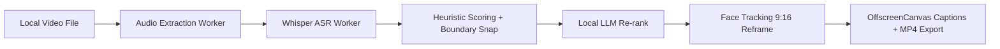

# ClipForge

**ClipForge** is a 100% free, open-source, browser-only web app that transforms long-form videos into viral-ready 9:16 vertical shorts with animated word-by-word captions.

- **Zero backend, zero accounts, zero API keys**
- **100% on-device privacy** — your videos never leave your machine
- **\$0 hosting cost** — pure static SPA deployable to Cloudflare Pages or GitHub Pages

## Architecture (WIP)



## Browser Support Matrix

| Feature | Chrome / Edge 113+ | Firefox 130+ | Safari 17+ |
| :--- | :--- | :--- | :--- |
| WebCodecs MP4 (Mediabunny) | Supported | Partial (FFmpeg fallback) | Supported |
| WebGPU ML Acceleration | Supported | Experimental (WASM fallback) | Experimental (WASM fallback) |
| MediaPipe Face Tracking | Supported | Supported | Supported |

## Local Development

```bash
npm install
npm run dev
```

## License

MIT — see [LICENSE](./LICENSE).
