# Hookcut

**Hookcut** is a 100% free, open-source, browser-only web app that turns long-form videos into viral-ready 9:16 vertical shorts with animated word-by-word captions.

- **Zero backend, zero accounts, zero user API keys**
- **100% on-device privacy** — videos are streamed locally and never leave your machine
- **\$0 hosting cost** — pure static SPA deployable to Cloudflare Pages or GitHub Pages

---

## Architecture

Every heavy computation runs inside dedicated Web Workers so the UI stays responsive at 60 fps.

```mermaid
flowchart LR
  File["Local Video File\n(<= 30 min, <= 1 GB)"] --> Validate["validateFile.ts\nSlice Fingerprint"]
  Validate --> AudioWorker["audioExtract.worker.ts\nMediabunny BlobSource -> 16 kHz Mono + RMS Energy"]
  AudioWorker --> WhisperWorker["whisper.worker.ts\nTransformers.js WebGPU / WASM + IndexedDB Cache"]
  WhisperWorker --> Heuristic["src/scoring/\n20-60s Sentence Windows + 9 Features + Penalties"]
  Heuristic --> Rerank["llmRerank.worker.ts\n1 Candidate/Call WebGPU LLM + Fallback"]
  Rerank --> Snap["boundarySnap.ts\nWord-Safe Cuts + Silence Trim + Hook Check"]
  Snap --> FaceWorker["faceTrack.worker.ts\nMediaPipe BlazeFace (~4 fps) + EMA Smoothing"]
  Snap --> Captions["src/captions/\n6 Presets + Keyword Emphasis + Safe Margins"]
  FaceWorker --> ExportWorker["videoExport.worker.ts\nOffscreenCanvas + Mediabunny MP4 (H.264 + AAC)"]
  Captions --> ExportWorker
  ExportWorker --> Fallback["ffmpeg.wasm Fallback\n(when WebCodecs H.264 unavailable)"]
```



---

## Browser Support Matrix

| Capability | Chrome / Edge 113+ | Firefox 130+ | Safari 17+ / iOS |
| :--- | :--- | :--- | :--- |
| Local File Streaming (`BlobSource`) | Full | Full | Full |
| Whisper ASR (`@huggingface/transformers`) | WebGPU (fast) + WASM fallback | WASM fallback (WebGPU experimental) | WASM fallback |
| Local LLM Re-ranker (`Qwen2.5-0.5B`) | WebGPU (when RAM >= 6 GB & cores >= 4) | Skipped (heuristic path) | Skipped (heuristic path) |
| Face Tracking (`MediaPipe BlazeFace`) | WebGL / CPU WASM | CPU / WebGL WASM | CPU / WebGL WASM |
| 9:16 MP4 Export (`H.264` + `AAC`) | Mediabunny + WebCodecs (hardware/fast) | Lazy `ffmpeg.wasm` fallback | Mediabunny + WebCodecs |
| `SharedArrayBuffer` (`COOP`/`COEP`) | Supported via `public/_headers` | Supported via `public/_headers` | Single-thread fallback |

On weaker or memory-constrained devices (`<= 4 GB` RAM, `<= 2` CPU cores, or no WebGPU), Hookcut automatically switches to `whisper-tiny.en`, disables the local LLM re-ranker, warns the user in the compatibility screen, and scales export limits cleanly.

---

## How Highlight Scoring Works

1. **Candidate Window Generation (`src/scoring/candidates.ts`)**:
   - Slides across sentence/utterance boundaries (`src/transcribe/normalizeWords.ts`) to produce candidate segments between `20s` and `60s` (`durationHardMin` .. `durationHardMax`).
2. **Normalized 0–1 Feature Scoring (`src/scoring/features.ts`)**:
   - `hook` (`0.25`): checks the first 3 seconds for a question, bold claim, number/statistic, contrast, or story opener.
   - `completeness` (`0.15`): verifies clean sentence start/end and self-contained context.
   - `emotion` (`0.12`): high-arousal emotional phrasing and exclamations.
   - `curiosity` (`0.10`): open loops, reveals, and unanswered questions.
   - `ending` (`0.10`): strong takeaway/punchline vs trailing filler.
   - `audioEnergy` (`0.10`): mean and 90th-percentile RMS energy relative to video baseline.
   - `speechRateChange` (`0.08`): pacing variation across 3-second sub-windows.
   - `laughter` (`0.05`): laughter cues and short high-energy burst patterns.
   - `topicCoherence` (`0.05`): lexical content overlap across adjacent sentences.
3. **Penalties & Overlap Deduplication (`src/scoring/penalties.ts`)**:
   - Penalizes windows with `> 25%` silence (`silenceMaxPenalty = 0.20`) or duration outside `25–45s` (`durationMaxPenalty = 0.15`).
   - Greedy non-max suppression keeps non-overlapping candidates (`maxOverlapRatio = 0.30`) and passes the top `12` (`candidatesToRerank`) to re-ranking.
4. **Local LLM Re-rank + Fallback (`src/scoring/rerankClient.ts`, `prompts/rerank_v1.md`)**:
   - Evaluates **one candidate per call** with strict JSON schema validation and verifies `hook_line` is a literal substring of the excerpt.
   - Retries once on invalid JSON/schema output, then falls back cleanly to the heuristic score.
   - Blends `finalScore = 0.4 * heuristicScore + 0.6 * llmScore`, filters `< 40`, and returns the top `5` clips.
5. **Boundary Snapping (`src/scoring/boundarySnap.ts`)**:
   - Trims leading silence, drops weak intro filler when the following sentence is a real hook, and guarantees cuts never split a word.

---

## Tuning Weights Locally

All weights, penalties, and re-rank parameters live in [`config/scoring.json`](./config/scoring.json).

Run the evaluation CLI on the built-in sample transcript or pass your own exported transcript JSON:

```bash
npm run eval
# Or evaluate a custom transcript JSON:
npx tsx scripts/eval.ts fixtures/sample-transcript.json
```

`scripts/eval.ts` prints each ranked clip with its raw weighted score, penalties, hook line, and full per-feature breakdown (`hook`, `completeness`, `emotion`, `curiosity`, `ending`, `audioEnergy`, `speechRateChange`, `laughter`, `topicCoherence`). Note that a unit test in `tests/unit/scoring.test.ts` enforces that `weights` in `config/scoring.json` sum to `1.0`.

---

## Local Development & Verification

```bash
npm install
npm run dev        # Starts Vite dev server with COOP/COEP headers
npm run lint       # ESLint checks
npm run typecheck  # TypeScript strict project check
npm test           # Vitest unit tests
npm run test:e2e   # Playwright E2E test on fixtures/sample-video.webm
npm run build      # Production static bundle in dist/
```

---

## Free Deploy Guide

### Option 1: Cloudflare Pages (Recommended — supports `_headers` for COOP/COEP)

1. Push this repository to GitHub.
2. Create a new project in **Cloudflare Pages** connected to your repo.
3. Configure build settings:
   - **Build command**: `npm run build`
   - **Build output directory**: `dist`
4. Cloudflare Pages automatically reads [`public/_headers`](./public/_headers) to serve `Cross-Origin-Opener-Policy: same-origin` and `Cross-Origin-Embedder-Policy: credentialless`, enabling `SharedArrayBuffer` for multi-threaded WASM at **$0/month**.

### Option 2: GitHub Pages

1. Set Vite `base` if deploying under a subpath (`/<repo-name>/`).
2. Deploy `dist/` via GitHub Actions (`actions/deploy-pages`).
3. Note: GitHub Pages does not allow custom HTTP response headers, so `crossOriginIsolated` will be `false` (WebCodecs + WebGPU still work at full speed in Chrome/Edge; `ffmpeg.wasm` runs single-threaded).

---

## Roadmap

- **v0.1.0 (Current)**: Local file streaming (30 min / 1 GB), device compatibility check, Whisper WebGPU/WASM + IndexedDB cache, heuristic + local LLM scoring, word-safe boundary snapping, MediaPipe 4 fps face tracking with smoothed 9:16 crop & blurred-background fallback, 6 animated caption presets, Mediabunny H.264/AAC MP4 export + `ffmpeg.wasm` fallback, local thumbnails & metadata, MIT license.
- **v0.2.0**: Visual timeline progress bar overlay, optional background music track with automatic voice ducking, and EBU R128 loudness normalization.
- **v0.3.0**: Automatic two-speaker 9:16 stacked split-screen layout for podcast/interview dialogues.

---

## Models & Licenses

See [`docs/MODELS.md`](./docs/MODELS.md) for every model ID, runtime, size, and license (`MIT` / `Apache-2.0`).

## Contributing & Support

Contributions are welcome! Read [`CONTRIBUTING.md`](./CONTRIBUTING.md) before opening a PR.
If Hookcut saves you time or money, consider supporting development via [GitHub Sponsors](https://github.com/sponsors/jayantshringi).

## License

[MIT](./LICENSE)
